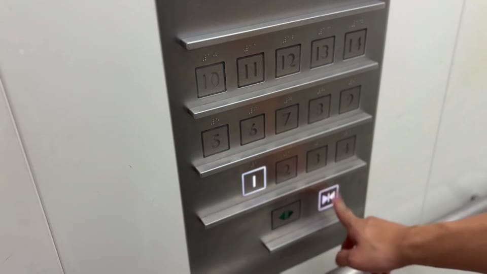

# エレベーター

日常のエレベーターを舞台にした約45秒の短編ホラー映像。

[作品を見る](https://eisuke29.github.io/portfolio/work6.html) · [ポートフォリオ](https://eisuke29.github.io/portfolio/)



## 作品について

身近な場所の違和感を、短い時間の中で積み重ねるホラー映像です。iPhone 17のシネマティックモードで撮影し、Canva Proで編集。個人制作。2026年6月15日上映公開（課題提出は6月13日）。

[完成映像（MP4・約45秒）](media/film.mp4)

## ローカルで動かす

このリポジトリのフォルダで次を実行し、http://localhost:8000/ を開きます。

```sh
python -m http.server 8000
```


## 制作者・権利

木下瑛介 / Eisuke Kinoshita（[Eisuke29](https://github.com/Eisuke29)）。共同制作・外部素材については上記の説明を参照してください。自作のコード・映像・デザインについて、別途記載のない限り無断での再配布は許諾していません。外部ライブラリ・モデル・フォント等にはそれぞれのライセンスが適用されます。
